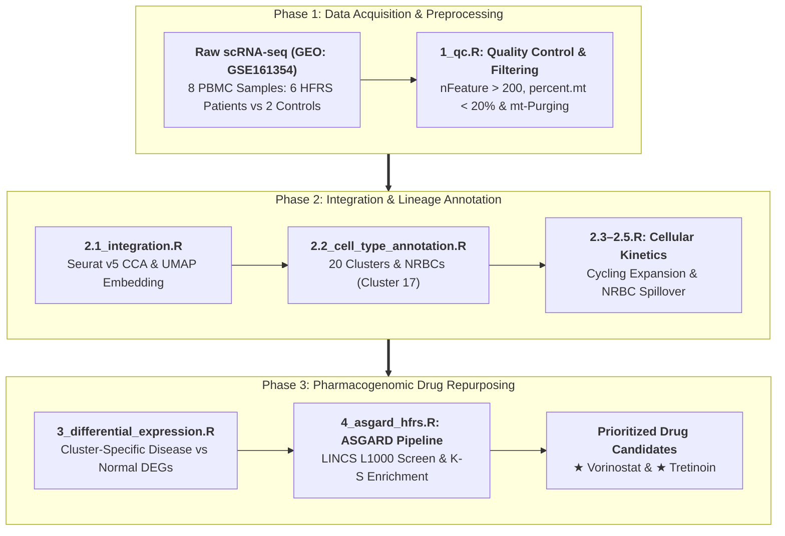

# scRNA-seq Guided In Silico Drug Repurposing Identifies Candidate Therapeutics for Hemorrhagic Fever with Renal Syndrome

**Author(s):** Md Abu Sadat Soash  
**Supervisor:** Prof. Dr. Gokul Chandra Biswas  
*Department of Genetic Engineering and Biotechnology*<br>
*Shahjalal University of Science and Technology, Sylhet, Bangladesh*

[](https://www.r-project.org/)
[](https://satijalab.org/seurat/)
[](https://github.com/lanagarmire/ASGARD)
[](https://www.ncbi.nlm.nih.gov/geo/query/acc.cgi?acc=GSE161354)
[](https://clue.io/)

---

## 📌 Abstract & Overview

* **Objective:** Hemorrhagic Fever with Renal Syndrome (HFRS) lacks targeted FDA-approved therapeutics. This study aims to identify novel therapeutic candidates capable of reversing the pathogenic transcriptomic signatures of HFRS, specifically targeting the abnormal presence of circulating Nucleated Red Blood Cells (NRBCs) and multilineage immune dysregulation.
* **Methodology:** We obtained peripheral blood mononuclear cell (PBMC) single-cell RNA sequencing (scRNA-seq) data from hospitalized HFRS patients and healthy controls. Utilizing **Seurat v5** for Canonical Correlation Analysis (CCA) data integration and the **ASGARD** (A Single-cell Guided Pipeline to Aid Repurposing of Drugs) computational framework, we extracted cluster-specific differential expression profiles and queried them against the **LINCS L1000** pharmacogenomic database across hematopoietic and lymphoid lineages.
* **Findings:** The multi-cluster ASGARD pipeline successfully identified 13 statistically significant FDA-approved drug candidates. **Vorinostat** (HDAC inhibitor) and **Tretinoin** (retinoic acid receptor agonist) emerged as the top rationally targeted candidates capable of mitigating lethal immune hyper-inflammation and overcoming HFRS-induced erythroid maturation arrest.
* **Implications:** This in silico framework translates high-resolution single-cell discoveries into actionable clinical candidates, establishing a strong rationale for immediate in vitro validation of Vorinostat and Tretinoin for HFRS management.

---

## 🔬 Biological Background & Motivation

Hemorrhagic Fever with Renal Syndrome (HFRS) is a life-threatening rodent-borne zoonosis caused by Old World hantaviruses, prominently **Hantaan virus (HTNV)**. Clinical progression traverses five distinct phases: *febrile, hypotensive, oliguric, polyuric,* and *convalescent*. During the oliguric phase, acute kidney injury (AKI) peaks, frequently culminating in pulmonary edema, hemorrhage, and multi-organ failure.

```
       Hantaan Virus (HTNV) Infection
                     │
         ┌───────────┴───────────┐
         ▼                       ▼
Vascular Endothelial Entry   Immune Hyper-Activation &
   (via αvβ3 Integrin)            Cytokine Storm
         │                       │
         ▼                       ▼
Endothelial Dysfunction,     Profound Thrombocytopenia &
Vascular Hyper-Permeability  Bone Marrow Erythropoietic Stress
         │                       │
         └───────────┬───────────┘
                     ▼
           Premature Release of
     Nucleated Red Blood Cells (NRBCs)
          & Acute Kidney Injury
```

1. **Vascular & Cytokine Crisis:** HTNV enters endothelial cells by binding $\alpha_v\beta_3$ integrin, promoting VE-cadherin disruption and capillary leakage without direct cytopathicity, amplified by a massive macrophage/monocyte-driven cytokine storm (TNF-$\alpha$, IL-1, IL-6).
2. **The NRBC Biomarker & Maturation Arrest:** Breakthrough scRNA-seq findings in HFRS PBMCs revealed the anomalous presence of circulating Nucleated Red Blood Cells (NRBCs), whose levels correlate directly with viral load and disease severity. HTNV infection and secondary micronutrient deficiencies (Vitamins B9/B12) provoke a severe erythroid maturation arrest, causing premature bone marrow spillover of immature precursors.
3. **The Research Void:** Clinical care remains strictly supportive (ribavirin offers narrow early benefit). Standard bulk transcriptomics dilutes rare pathological subsets like NRBCs. By applying single-cell transcriptomics paired with multi-cluster drug reversal scoring (**ASGARD**), this project systematically evaluates therapeutics across heterogeneous cellular lineages.

---

## 🛠️ Computational Pipeline Architecture



---

## 📊 Key Findings

### 1. Cellular Distribution & Composition Remodeling

Quantitative shifts across the cellular landscape reveal intense bone marrow stress and peripheral activation in acute HFRS:

| Cell Type | Within-Cluster Healthy (%) | Within-Cluster Disease (%) | Global Healthy Pool (% of Total) | Global Disease Pool (% of Total) | Biological Significance |
| :--- | :---: | :---: | :---: | :---: | :--- |
| **Cycling cells** | 2.00% | **98.00%** | 1.43% | **22.16%** | Massive expansion of proliferating cytotoxic CD8+ T cells (*CCNA2*, *CDK1*, *MCM2*) |
| **CD8+ T cells** | 19.19% | **80.81%** | 12.53% | **16.71%** | Clonal cytotoxic effector mobilization |
| **Classical Monocytes** | 15.72% | **84.28%** | 4.60% | **7.81%** | Major drivers of hyper-inflammatory cytokine production |
| **Plasma cells** | 0.66% | **99.34%** | 0.14% | **6.62%** | Dramatic surge into antibody-secreting factories |
| **B cells** | 7.94% | **92.06%** | 1.36% | **5.01%** | Humoral immune activation |
| **NRBCs (Cluster 17)** | 2.07% | **97.93%** | 0.08% | **1.14%** | Pathological peripheral spillover of immature erythroids (*AHSP*, *HBA1/2*, *HBB*, *GYPA/B*) |
| **NK cells** | 46.16% | 53.84% | 16.62% | 6.14% | Relative peripheral redistribution / consumption |
| **Naive T cells** | 60.30% | 39.70% | 35.08% | **7.31%** | Exhaustion/differentiation of resting immune reserve |

### 2. Prioritized FDA-Approved Repurposing Candidates

Querying single-cell signatures against the **LINCS L1000** hematopoietic/lymphoid reference database identified **13 statistically significant FDA-approved therapeutics**:

| Rank | Candidate | Therapeutic Score | $P$-Value | FDR | Primary Mechanism of Action |
| :---: | :--- | :---: | :---: | :---: | :--- |
| **1** | **Vorinostat** | **0.3701** | $2.27 \times 10^{-17}$ | $1.93 \times 10^{-15}$ | Histone Deacetylase (HDAC) Inhibitor |
| **2** | **Everolimus** | 0.1881 | $1.09 \times 10^{-8}$ | $3.10 \times 10^{-7}$ | mTOR Kinase Inhibitor (mTORC1) |
| **3** | **Daunorubicin** | 0.1757 | $3.07 \times 10^{-8}$ | $6.52 \times 10^{-7}$ | Topoisomerase II Inhibitor / DNA Intercalator |
| **4** | **Tretinoin (ATRA)** | **0.1582** | $7.07 \times 10^{-10}$ | $3.00 \times 10^{-8}$ | Retinoic Acid Receptor (RAR) Agonist |
| **5** | **Sirolimus** | 0.1495 | $7.82 \times 10^{-5}$ | $9.50 \times 10^{-4}$ | mTOR Kinase Inhibitor |
| **6** | **Curcumin** | 0.1306 | $2.36 \times 10^{-5}$ | $3.35 \times 10^{-4}$ | NF-$\kappa$B and COX-2 Inhibitor |
| **7** | **Perhexiline** | 0.1232 | $1.04 \times 10^{-6}$ | $1.78 \times 10^{-5}$ | CPT-1 Inhibitor |
| **8** | **Calcitriol** | 0.1123 | $3.02 \times 10^{-4}$ | $3.21 \times 10^{-3}$ | Vitamin D Receptor (VDR) Agonist |
| **9** | **Nicardipine** | 0.1000 | $8.82 \times 10^{-4}$ | $7.50 \times 10^{-3}$ | L-type $\text{Ca}^{2+}$ Channel Blocker |
| **10** | **Rucaparib** | 0.0925 | $4.70 \times 10^{-3}$ | $3.07 \times 10^{-2}$ | PARP Inhibitor |
| **11** | **Itraconazole** | 0.0806 | $4.10 \times 10^{-3}$ | $2.90 \times 10^{-2}$ | CYP51 Inhibitor |
| **12** | **Iloprost** | 0.0786 | $2.02 \times 10^{-3}$ | $1.56 \times 10^{-2}$ | Prostacyclin ($\text{PGI}_2$) Receptor Agonist |
| **13** | **Parthenolide** | 0.0601 | $3.46 \times 10^{-4}$ | $3.27 \times 10^{-3}$ | NF-$\kappa$B / IKK Inhibitor |

### 3. Mechanistic Rationale for Top Translational Hits

```
                     ┌────────────────────────────────────────┐
                     │          Vorinostat (Rank 1)           │
                     │          ───────────────────           │
                     │  • Epigenetic chromatin remodeling     │
                     │  • Suppresses myeloid cytokine storm   │
                     │  • Stabilizes endothelial barriers     │
                     └────────────────────────────────────────┘

                     ┌────────────────────────────────────────┐
                     │          Tretinoin (Rank 4)            │
                     │          ───────────────────           │
                     │  • Bypasses erythroid maturation block │
                     │  • Drives terminal NRBC enucleation    │
                     │  • Alleviates tissue hypoxia & AKI     │
                     └────────────────────────────────────────┘
```

* **Vorinostat (SAHA - Score: 0.3701):** Broad cytotoxic agents and deep immunosuppressants (e.g. Daunorubicin, Everolimus) pose severe safety risks during acute hemorrhagic fever. In contrast, Vorinostat epigenetically downregulates hyperactive pro-inflammatory transcription in myeloid cells while preserving and stabilizing endothelial tight junctions, addressing the dual threat of cytokine storm and vascular collapse.
* **Tretinoin (ATRA - Score: 0.1582):** Stalled NRBCs share molecular vulnerabilities with arrested leukemic promyelocytes. Tretinoin functions as a potent differentiation agent that overcomes the HTNV- and metabolic-induced maturation blockade, driving terminal enucleation and differentiation to restore erythrocyte homeostasis and relieve hypoxic stress exacerbating acute kidney injury.

---

## 📂 Repository Organization

```text
.
├── R/                                   # R Pipeline Scripts
│   ├── 1_qc.R                           # Phase 1: Quality control, cell filtering, mt-gene purging
│   ├── 2.1_integration.R                # Phase 2.1: Seurat v5 CCA integration & UMAP embedding
│   ├── 2.2_cell_type_annotation.R       # Phase 2.2: Cluster marker extraction & cell type annotation
│   ├── 2.3_cluster_distribution.R       # Phase 2.3: Cell type composition & distribution calculations
│   ├── 2.4.R                            # Phase 2.4: Supplementary distribution analysis
│   ├── 2.5.R                            # Phase 2.5: Auxiliary visualization scripts
│   ├── 3_differential_expression.R      # Phase 3: Cluster-specific DEG extraction (Disease vs Normal)
│   └── 4_asgard_hfrs.R                  # Phase 4: ASGARD LINCS L1000 drug repurposing pipeline
├── result/                              # Analysis outputs and figures
│   ├── ASGARD_HFRS_Candidates.csv       # Ranked drug candidates with statistical scores
│   ├── Annotated_UMAP.pdf               # UMAP embeddings colored by annotated cell types
│   ├── Phase2_Integration_UMAPs.pdf     # Integration verification plots
│   ├── Phase2_RBC_Markers.pdf           # NRBC hallmark marker feature plots (HBA1, HBA2, HBB)
│   ├── Verification_FeaturePlots.pdf    # Canonical marker verification plots
│   ├── CellType_Composition_Plots.pdf   # Quantitative cell composition comparisons
│   └── Cluster_Distribution_Plots.pdf   # Cluster distribution shifts across conditions
├── database/                            # Reference databases (local storage)
│   └── L1000/                           # LINCS L1000 .gctx matrix files & metadata
├── dump/                                # Presentations, templates, and working drafts
├── paper/                               # Key foundational literature and methodological references
├── manuscript.docx                      # Full study manuscript
└── README.md                            # Comprehensive project documentation
```

---

## ⚙️ Installation & Prerequisites

This pipeline requires **R (>= 4.1.0)**. Ensure sufficient computational memory (recommended $\ge$ 32GB RAM for CCA integration).

```R
# 1. Install CRAN packages
install.packages(c("dplyr", "ggplot2", "future", "qs2", "tibble", "tidyr"))

# 2. Install Seurat v5
install.packages("Seurat")

# 3. Install ASGARD and Bioconductor dependencies
if (!requireNamespace("BiocManager", quietly = TRUE))
    install.packages("BiocManager")
BiocManager::install(c("rhdf5", "limma", "GEOquery"))

# Install ASGARD from GitHub
devtools::install_github("lanagarmire/ASGARD")
```

---

## 🚀 Reproduction Walkthrough

### Step 1: Data Acquisition
Download the raw 10X Genomics matrix files from NCBI GEO:
* Accession: **[GSE161354](https://www.ncbi.nlm.nih.gov/geo/query/acc.cgi?acc=GSE161354)**
* Place patient samples into `GSE161354_RAW/disease` (`Y04`, `Y06`, `Y07`, `Y15`, `Y16`, `Y26`) and `GSE161354_RAW/normal` (`YYZ`, `YTK`).

Download the LINCS L1000 perturbation profiles and place them in `database/L1000/`:
* `GSE92742_Broad_LINCS_Level5_COMPZ.MODZ_n473647x12328.gctx`
* `GSE70138_Broad_LINCS_Level5_COMPZ_n118050x12328_2017-03-06.gctx`

### Step 2: Execute Sequential Pipeline
```bash
# 1. Quality Control & Filtering
Rscript R/1_qc.R

# 2. CCA Integration & Clustering
Rscript R/2.1_integration.R

# 3. Cell Type Annotation & Distribution
Rscript R/2.2_cell_type_annotation.R
Rscript R/2.3_cluster_distribution.R

# 4. Cluster-Specific Differential Expression
Rscript R/3_differential_expression.R

# 5. ASGARD Drug Repurposing Pipeline
Rscript R/4_asgard_hfrs.R
```

---

## ✒️ Citation & Authorship

If you use this pipeline, analysis code, or findings in your research, please cite:

> **Md Abu Sadat Soash** (2026). *scRNA-seq Guided In Silico Drug Repurposing Identifies Candidate Therapeutics for Hemorrhagic Fever with Renal Syndrome.* Department of Genetic Engineering and Biotechnology, Shahjalal University of Science and Technology, Sylhet, Bangladesh.  
> GitHub: [https://github.com/Soash/hfrs-scrna-drug-repurposing](https://github.com/Soash/hfrs-scrna-drug-repurposing)

### ✉️ Contact
**Md Abu Sadat Soash**  
Department of Genetic Engineering and Biotechnology, Shahjalal University of Science and Technology  
Email: [mdabu13@student.sust.edu](mailto:mdabu13@student.sust.edu)
